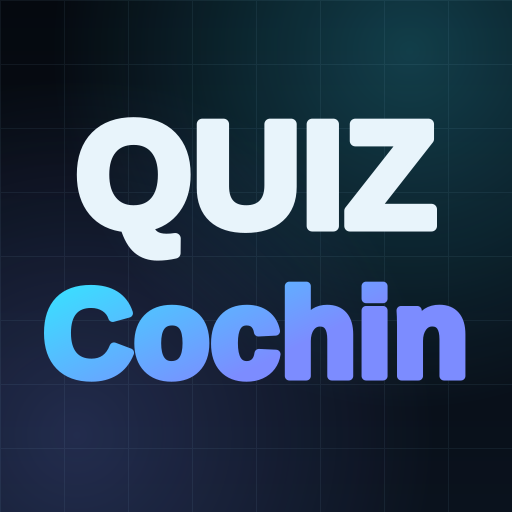

# QUIZ Imagerie Cochin — 1 Image · 1 Diagnostic

Version épurée de **Quiz Cochin** centrée sur le diagnostic radiologique sur image unique :

- **1 Image = 1 Quiz** : visionneuse radiologique intégrée (zoom, déplacement, fenêtrage contraste/luminosité, inversion négatif/positif, plein écran) + saisie libre du diagnostic avec **autocomplétion** et **validation souple** (synonymes, mots-clés et tolérance orthographique).
- **Flux direct & Filtres** : filtrage instantané par région anatomique, modalité (`Radiographie`, `IRM`, `Arthroscanner / TDM`, `Échographie`) et statut (`À faire`, `Réussis`, `À revoir`, `Favoris`), avec mode Mixte, Focus Quiz ou Galerie d'images.
- **Studio d'ajout / édition rapide (`#/studio`)** : ajout de nouveaux cas par glisser-déposer ou **coller depuis le presse-papiers (`Cmd+V`)**, compression d'image côté navigateur, simulateur de validation souple en direct et import/export JSON.

## Commandes

```bash
npm install
npm run dev      # Serveur de développement (http://localhost:5173)
npm run build    # Build de production
```
